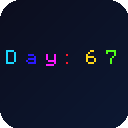

# Better Day Counters

A lightweight Fabric mod for Minecraft 26.3 that replaces the vanilla day counter with a fully customizable on-screen indicator.



## Features

- Shows the current Minecraft day using the same world clock as the vanilla `day_count` debug entry
- Fully configurable on-screen display:
  - Anchor (9 screen positions)
  - Scale (0.5x – 3.0x)
  - Text and background colors
  - Solid or rainbow (animated) text, background, and glow
  - Optional glow halo with custom or rainbow color
  - Shadow toggle
  - Prefix text
  - Roman numeral mode
- Automatically hides the vanilla `day_count` debug line while enabled
- Settings saved to `config/better_day_counters.json`
- Default keybind: **K** (rebindable in Options → Controls)

## Requirements

- Minecraft Java Edition **26.3**
- Fabric Loader **0.19.5+**
- Fabric API **0.162.0+26.3**
- Java **25**

## Installation

1. Install the [Fabric Loader](https://fabricmc.net/) for Minecraft 26.3.
2. Download Fabric API and this mod.
3. Place both `.jar` files in your `mods` folder.
4. Launch the game.

## Usage

The day counter appears automatically in the **top-left corner** by default as soon as you join a world. Press **K** (or your rebound key) to open the settings screen and customize it.

If you previously enabled the vanilla `day_count` debug entry via **F3 + F6**, this mod temporarily disables that built-in line to avoid duplicate counters.

## Configuration

Settings are stored at:

```
.minecraft/config/better_day_counters.json
```

You can edit it directly or use the in-game settings screen.

## Building from Source

```bash
./gradlew build
```

The compiled jar will be in `build/libs/`.

## License

MIT